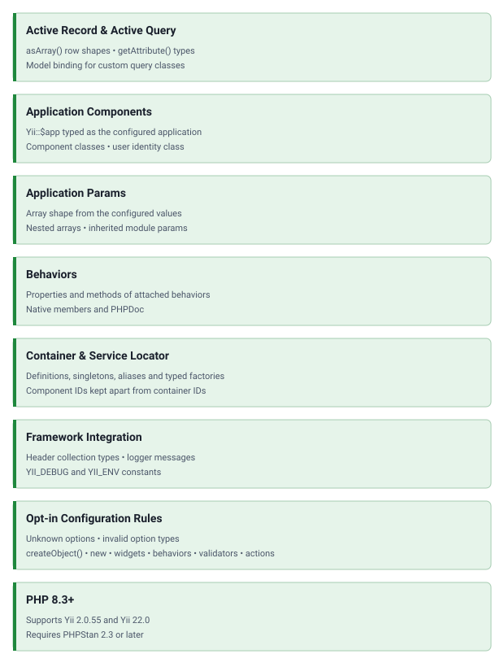

<!-- markdownlint-disable MD041 -->
<p align="center">
    <picture>
        <source media="(prefers-color-scheme: dark)" srcset="https://www.yiiframework.com/image/design/logo/yii3_full_for_dark.svg">
        <source media="(prefers-color-scheme: light)" srcset="https://www.yiiframework.com/image/design/logo/yii3_full_for_light.svg">
        
    </picture>
    <h1 align="center">PHPStan</h1>
    <br>
</p>
<!-- markdownlint-enable MD041 -->

<p align="center">
    <a href="https://github.com/yii2-extensions/phpstan/actions/workflows/build.yml" target="_blank">
        
    </a>
    <a href="https://codecov.io/github/yii2-extensions/phpstan" target="_blank">
        
    </a>
    <a href="https://github.com/yii2-extensions/phpstan/actions/workflows/static.yml" target="_blank">
        
    </a>
</p>

<p align="center">
    <strong>Enhanced static analysis for Yii2 applications with PHPStan</strong><br>
    <em>Precise type inference, dynamic method resolution, and comprehensive property reflection</em>
</p>

## Features

<picture>
    <source media="(min-width: 768px)" srcset="https://raw.githubusercontent.com/yii2-extensions/phpstan/main/docs/svgs/features.svg">
    
</picture>

## Quick start

### Installation

```bash
composer require --dev yii2-extensions/phpstan:^0.6
```

Requirements, version selection and bootstrap files are covered in the
[Installation Guide](https://github.com/yii2-extensions/phpstan/blob/main/docs/installation.md).

### Usage

A blog: `Article` declares `@property` tags for `id`, `title` and `status`, and its `find()` returns an `ArticleQuery`
with a `published()` scope. `SlugBehavior` adds a `slug` property and a `permalink()` method, `Feed` is a component with
a string `url` and an integer `limit`, and `User` is the identity class.

Create `config/phpstan.php`. PHPStan reads it to learn what the application contains; it never configures the running
application:

```php
<?php

declare(strict_types=1);

return [
    // Becomes an array shape: each key keeps the type of its value.
    'params' => [
        'adminEmail' => 'admin@example.com',
        'pageSize' => 20,
    ],
    // Component IDs, read as Yii::$app->feed or Yii::$app->get('feed').
    'components' => [
        'feed' => ['class' => app\components\Feed::class],
        // identityClass also types Yii::$app->user->identity.
        'user' => [
            'class' => yii\web\User::class,
            'identityClass' => app\models\User::class,
        ],
    ],
    // Container IDs, read as Yii::$container->get('feed.latest').
    'container' => [
        'singletons' => [
            'feed.latest' => ['class' => app\components\Feed::class],
        ],
    ],
    // Behaviors the application attaches at runtime: their members become visible on the owner.
    'behaviors' => [
        app\models\Article::class => [app\behaviors\SlugBehavior::class],
    ],
];
```

Create `phpstan.neon` in the project root, choosing paths that exist in your application, and run
`vendor/bin/phpstan analyse`:

```neon
includes:
    - vendor/yii2-extensions/phpstan/extension.neon

parameters:
    level: 5
    paths:
        - models
    yii2:
        config_path: config/phpstan.php
```

PHPStan now knows the types that Yii resolves at runtime:

```php
use app\models\Article;

// Active Record: the custom query stays bound to its model through scopes.
$article = Article::findOne(1);                           // Article|null
$query = Article::find()->published();                    // ArticleQuery&ActiveQuery<Article>
$articles = $query->all();                                // array<Article>

// Rows take their shape from the @property tags of the model.
$rows = Article::find()->published()->asArray()->all();   // array<array{id: int, title: string, status: string}>

if ($article !== null) {
    $title = $article->getAttribute('title');             // string
    // Members of the behavior declared for Article.
    $slug = $article->slug;                               // string
    $url = $article->permalink();                         // string
}

// Application: Yii::$app is typed without null, and each component has its configured class.
$feed = Yii::$app->feed;                                  // app\components\Feed
$request = Yii::$app->request;                            // yii\web\Request
$identity = Yii::$app->user->identity;                    // app\models\User|null
$pageSize = Yii::$app->params['pageSize'];                // int
$email = Yii::$app->params['adminEmail'];                 // string

// Container: services are resolved by their own IDs, apart from component IDs.
$latest = Yii::$container->get('feed.latest');            // app\components\Feed
```

Opt-in rules check the configuration arrays that Yii only validates when the code runs. Enable the ones you need:

```neon
parameters:
    yii2:
        rules:
            createObjectUnknownOption: true
            createObjectInvalidOptionType: true
            newUnknownOption: true
```

```php
use app\components\Feed;

// Valid: both options exist and accept these values.
Yii::createObject(['class' => Feed::class, 'url' => '/rss', 'limit' => 20]);

// yii2.createObject.unknownOption: Feed has no public property or setter named "limits".
Yii::createObject(['class' => Feed::class, 'url' => '/rss', 'limits' => 20]);

// yii2.createObject.invalidOptionType: "limit" accepts only int, even with type coercion.
Yii::createObject(['class' => Feed::class, 'url' => '/rss', 'limit' => 'all']);

// yii2.new.unknownOption: the same check for a direct construction.
new Feed(['uri' => '/rss']);
```

Every rule is disabled by default. The
[Configuration Guide](https://github.com/yii2-extensions/phpstan/blob/main/docs/configuration.md) lists them all,
including the ones for widgets, behaviors, validators and external actions, and details console applications, generic
components and container definition forms. Custom query classes, optional row keys, the service locator, headers and
logger messages are in the [Usage Examples](https://github.com/yii2-extensions/phpstan/blob/main/docs/examples.md).

## Documentation

Practical guides and complete examples for Yii type inference and application analysis.

- 📚 [Installation Guide](https://github.com/yii2-extensions/phpstan/blob/main/docs/installation.md)
- ⚙️ [Configuration Guide](https://github.com/yii2-extensions/phpstan/blob/main/docs/configuration.md)
- 💡 [Usage Examples](https://github.com/yii2-extensions/phpstan/blob/main/docs/examples.md)
- 🔄 [Upgrade Guide](UPGRADE.md) and
  [Migration Guide](https://github.com/yii2-extensions/phpstan/blob/main/docs/migration.md)
- 🧪 [Testing Guide](https://github.com/yii2-extensions/phpstan/blob/main/docs/testing.md)

The guides and the [API reference](https://yii2-framework.github.io/docs/extensions/phpstan/reference/) generated from
the PHPDoc in `src/` are published at <https://yii2-framework.github.io/docs/extensions/phpstan/>.

## AI assistance

AI agents: read the [documentation index](https://yii2-framework.github.io/docs/llms.txt) and fetch the Markdown version
of a page by appending `index.md` to its URL. The
[AI agents guide](https://yii2-framework.github.io/docs/project/ai-agents/) covers skill installation, client setup and
verification.

- 🤖 [`yii2-phpstan-analysis` skill](https://github.com/yii2-extensions/phpstan/blob/main/docs/agents.md): extension
  setup with separate Web and console analyses, diagnosis of component, params, behavior, container and Active Record
  inference, the opt-in configuration rules, and 0.4-to-0.5 migration.
- 🧭 [`yii2-framework` skill](https://yii2-framework.github.io/docs/guide/skills/yii2-framework/): Yii 22.0 application
  conventions.

The hosted documentation covers Yii 22.0. If it does not match the installed revision or is unavailable, use the
[repository guides](#documentation), the [skill source](skills/yii2-phpstan-analysis/SKILL.md), the source PHPDoc and
the [changelog](CHANGELOG.md).

## Package information

[](https://www.php.net/releases/8.3/en.php)
[](https://github.com/yiisoft/yii2/releases/tag/2.0.55)
[](https://github.com/yiisoft/yii2/tree/22.0)
[](https://packagist.org/packages/yii2-extensions/phpstan)
[](https://packagist.org/packages/yii2-extensions/phpstan)

## Project status

[](https://github.com/yii2-extensions/phpstan/actions/workflows/static.yml)
[](https://github.com/yii2-extensions/phpstan/actions/workflows/quality.yml)
[](https://github.styleci.io/repos/701347895?branch=main)

## Security

[](https://scorecard.dev/viewer/?uri=github.com/yii2-extensions/phpstan)
[](https://github.com/yii2-extensions/phpstan/actions/workflows/security.yml)

## Built with AI

[](https://claude.com/claude-code)
[](https://openai.com/codex)
[](https://www.coderabbit.ai)

## Our social networks

[](https://x.com/Terabytesoftw)
[](https://www.facebook.com/wilmer.arambula.9)
[](https://www.reddit.com/r/Yii2/)
[](https://t.me/yii_framework_in_english)

## License

[](LICENSE)
