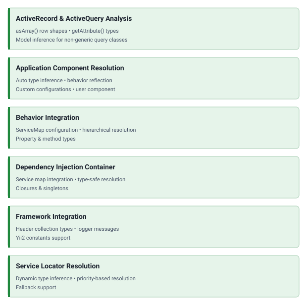

<!-- markdownlint-disable MD041 -->
<p align="center">
    <picture>
        <source media="(prefers-color-scheme: dark)" srcset="https://www.yiiframework.com/image/design/logo/yii3_full_for_dark.svg">
        <source media="(prefers-color-scheme: light)" srcset="https://www.yiiframework.com/image/design/logo/yii3_full_for_light.svg">
        
    </picture>
    <h1 align="center">PHPStan</h1>
    <br>
</p>
<!-- markdownlint-enable MD041 -->

<p align="center">
    <a href="https://github.com/yii2-extensions/phpstan/actions/workflows/build.yml" target="_blank">
        
    </a>
    <a href="https://github.com/yii2-extensions/phpstan/actions/workflows/static.yml" target="_blank">
        
    </a>
    <a href="https://github.com/yii2-extensions/phpstan/actions/workflows/security.yml" target="_blank">
        
    </a>
</p>

<p align="center">
    <strong>Enhanced static analysis for Yii2 applications with PHPStan</strong><br>
    <em>Precise type inference, dynamic method resolution, and comprehensive property reflection</em>
</p>

## Features

<picture>
    <source media="(min-width: 768px)" srcset="./docs/svgs/features.svg">
    
</picture>

### Installation

```bash
composer require --dev yii2-extensions/phpstan:^0.5
```

### Quick start

Create `config/phpstan.php` with an analysis-only description of your application:

```php
<?php

declare(strict_types=1);

return [
    'params' => ['adminEmail' => 'admin@example.com'],
    'components' => [
        'db' => ['class' => yii\db\Connection::class],
    ],
];
```

Create `phpstan.neon` in the project root, choosing paths that exist in your application:

```neon
includes:
    - vendor/yii2-extensions/phpstan/extension.neon

parameters:
    level: 5
    paths:
        - models
    yii2:
        config_path: config/phpstan.php
```

Run PHPStan:

```bash
vendor/bin/phpstan analyse
```

### Type inference examples

The snippets below assume an `app\models\Article` model with `id` and `title` property tags and a `published()`
query scope. The [usage guide](docs/examples.md) describes the analysis configuration for the components, params and
behaviors shown here.

#### Active Record

Yii supplies generic types for `findOne()`, `findAll()`, relations and the standard query methods. This extension
adds row shapes from model `@property` tags and precise `getAttribute()` types:

```php
use app\models\Article;

$article = Article::findOne(1);                   // Article|null
$articles = Article::findAll(['title' => 'Yii']); // array<Article>
$query = Article::find()->where(['id' => 1]);     // ArticleQuery&ActiveQuery<Article>
$published = Article::find()->published()->one(); // Article|null
$rows = Article::find()->asArray()->all();        // array<array{id: int, title: string}>

if ($article !== null) {
    $title = $article->getAttribute('title');     // string
}
```

A custom query without generic PHPDoc, such as one generated by Gii, is bound to the model at the `find()` call site.
Use `static` or `$this` scope return types to preserve that binding. Row shapes include inherited property tags;
relation and read-only keys are optional and need guards such as `??`. See [query limitations](docs/examples.md#custom-active-query-classes)
when a query is reached through a typed parameter or a widened relation getter.

#### Application components

`Yii::$app` uses `phpstan.application_type`, which defaults to `yii\web\Application`. Component classes come from
the analysis configuration:

```php
$view = Yii::$app->exampleView;           // yii\web\View
$typed = Yii::$app->get('typedView');     // yii\web\View
$untyped = Yii::$app->get('untypedView'); // object
$request = Yii::$app->request;            // yii\web\Request
```

Class names, class-key arrays, object instances and factories with a single class return type can provide precise
types. An untyped factory yields `object`; adding an accurate return type makes the result specific. Core components
configured without a class keep the application's annotated property type.

The built-in `user: identityClass` mapping also supplies the configured identity class to `yii\web\User`'s generic
parameter. Its `identity` property remains nullable. See [generic components](docs/configuration.md#generic-components)
and the separate [console application configuration](docs/configuration.md#web-console-and-custom-applications).

#### Application params

Params values become an array shape, including nested arrays and keys containing dots or other punctuation:

```php
$email = Yii::$app->params['adminEmail'];          // string
$maxItems = Yii::$app->params['maxItems'];         // int
$enabled = Yii::$app->params['nested']['enabled']; // bool
```

Scalars are widened to their types rather than retained as literal values. The same shape applies to inherited
module params, including `$this->module->params` in a controller. With no configured params, the type stays `array`.

#### Behaviors

The analysis-only `behaviors` map exposes members from attached behavior classes. In the example,
`TaggedComponent` is mapped to `TagBehavior`; the application must also attach that behavior at runtime:

```php
use app\behaviors\TagBehavior;
use app\components\TaggedComponent;

$component = new TaggedComponent();

$component->attachBehavior('tag', new TagBehavior());

$label = $component->label;         // string
$summary = $component->summarize(); // string
```

Properties and methods are resolved from the behavior's native members and PHPDoc.
See [behavior configuration](docs/configuration.md#behaviors).

#### Dependency injection

Container service definitions and aliases are resolved by their IDs:

```php
$view = Yii::$container->get('view.alias');   // yii\web\View
$shared = Yii::$container->get('sharedView'); // yii\web\View
```

The example config maps `view.alias` to `view.real` and gives `sharedView` a typed factory. An unresolved definition
keeps the result as `object`. Container factories, invocable objects and aliases have distinct rules; see
[definition forms](docs/configuration.md#definition-forms).

#### Header collection

```php
$headers = new yii\web\HeaderCollection();

$host = $headers->get('Host');                         // string|null
$ids = $headers->get('X-Request-ID', [], false);       // array<string>
$requestId = $headers->get('X-Request-ID', 'default'); // string
```

A non-null default removes `null` from the return type. The `$first` argument selects a single value or an array.

#### Logger messages

Logger and target message buffers have tuple types without local stubs or PHPDoc overrides:

```php
foreach ((new yii\log\Logger())->messages as $message) {
    $level = $message[1];          // int
    $category = $message[2];       // string
    $timestamp = $message[3];      // float
    $memory = $message[5] ?? null; // int|null
}

$empty = yii\log\Target::filterMessages([]); // array{}
```

Payload types follow the installed Yii version. Filtering preserves the input key and tuple types while allowing
an empty result. See the [logger examples](docs/examples.md#headers-and-logger-messages).

#### Service locator

A service locator resolves configured component IDs, while container-only IDs belong to the container:

```php
$view = Yii::$app->get('exampleView');            // yii\web\View
$optional = Yii::$app->get('exampleView', false); // yii\web\View|null
$unknown = Yii::$app->get('view.alias');          // object; not a configured component ID
```

Passing `false` or a non-constant boolean as `$throwException` makes a resolved component nullable. An `object`
fallback does not guarantee a successful runtime lookup: unknown component IDs can throw. Use
`Yii::$container->get('view.alias')` for the configured container alias.

## Documentation

Practical guides and complete examples for Yii type inference and application
analysis.

- 📚 [Installation Guide](docs/installation.md)
- ⚙️ [Configuration Guide](docs/configuration.md)
- 💡 [Usage Examples](docs/examples.md)
- 🔄 [Migration Guide](docs/migration.md) and [Upgrade Entry Point](UPGRADE.md)
- 🧪 [Testing Guide](docs/testing.md)

## AI assistance

AI agents: use the repository guides and source for the installed revision.
For a [documentation deployment](https://yii2-framework.github.io/docs/) with
`llms.txt`, read that index first. When Markdown export is enabled, append
`index.md` to a page URL. For Yii conventions, install the `yii2-framework`
skill from [`yii2-extensions/skill`](https://github.com/yii2-extensions/skill)
through the [shared Composer setup](https://yii2-framework.github.io/docs/project/ai-agents/#composer-installation).

- 🤖 [yii2-phpstan-analysis skill](docs/agents.md): installation for Claude
  Code, Codex, and OpenCode.

If the hosted sources are unavailable, use the repository guides and locally
available skills.

## Package information

[](https://www.php.net/releases/8.3/en.php)
[](https://github.com/yiisoft/yii2/releases/tag/2.0.55)
[](https://github.com/yiisoft/yii2/tree/22.0)
[](https://packagist.org/packages/yii2-extensions/phpstan)
[](https://packagist.org/packages/yii2-extensions/phpstan)

## Project status

[](https://codecov.io/github/yii2-extensions/phpstan)
[](https://github.com/yii2-extensions/phpstan/actions/workflows/static.yml)
[](https://github.com/yii2-extensions/phpstan/actions/workflows/quality.yml)
[](https://github.styleci.io/repos/701347895?branch=main)

## Our social networks

[](https://x.com/Terabytesoftw)
[](https://www.facebook.com/wilmer.arambula.9)
[](https://www.reddit.com/r/Yii2/)
[](https://t.me/yii_framework_in_english)

## License

[](LICENSE)
